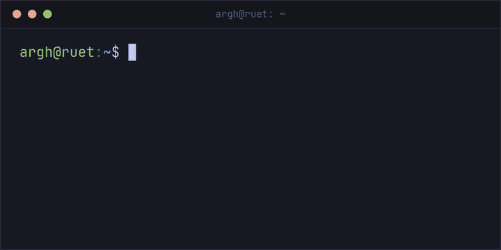

 

  

<!-- LinkedIn and Portfolio (add when ready): replace the YOUR-... parts, then delete the LINKS START line and the LINKS END line below so they show. -->
<!-- LINKS START

LINKS END -->

CSE student at **RUET**. I build full-stack web apps with React and MongoDB, 
and I like getting closer to the hardware with C++, Python and Assembly.

<h2 align="center">Stack</h2>

  

<h2 align="center">Selected work</h2>

- **[CivicNest](https://github.com/argh-finds404/CivicNest-Client)**: the full-stack app I'm building now. [Client](https://github.com/argh-finds404/CivicNest-Client) · [Server](https://github.com/argh-finds404/CivicNest-Server)
- **[hero.io](https://github.com/argh-finds404/hero.io-app-store)**: an app store with a frosted-glass look and a live analytics dashboard
- **[ToyTopia](https://github.com/argh-finds404/ToyTopia-toy-store)**: a toy store that plays more like a game than a shop
- **[Joruri Seba](https://github.com/argh-finds404/Joruri-seba-emergency-hotline)**: a directory of Bangladesh's emergency helplines, with call history
- **[Hospital Management](https://github.com/argh-finds404/Hospital-Management-python)**: a hospital management system in Python

<picture>
  <source media="(prefers-color-scheme: dark)" srcset="https://raw.githubusercontent.com/argh-finds404/argh-finds404/output/github-contribution-grid-snake-dark.svg" />
  <source media="(prefers-color-scheme: light)" srcset="https://raw.githubusercontent.com/argh-finds404/argh-finds404/output/github-contribution-grid-snake.svg" />
  
</picture>

