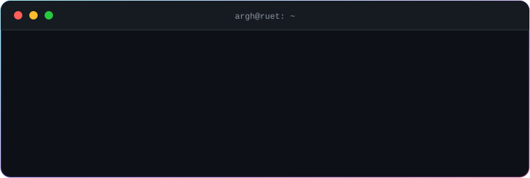
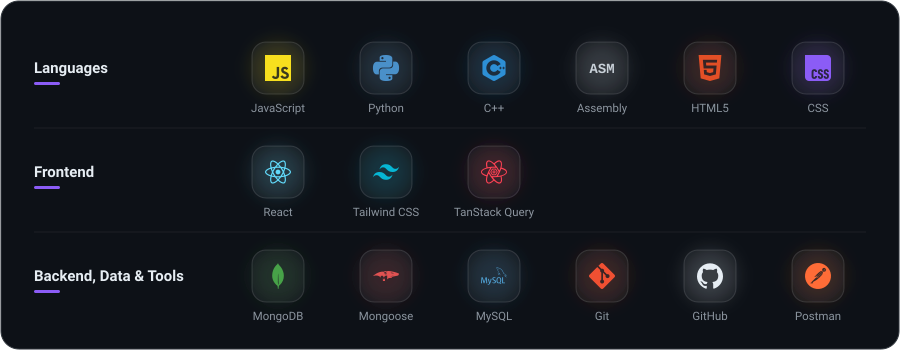
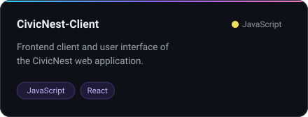
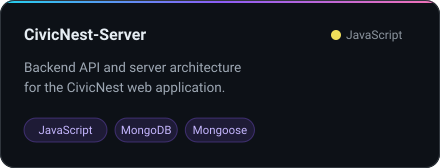
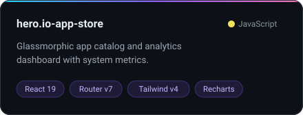
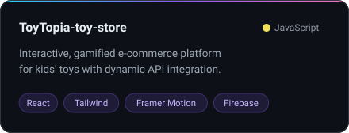
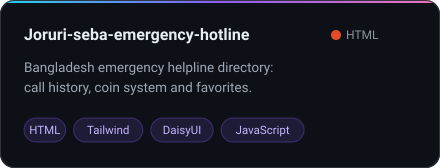
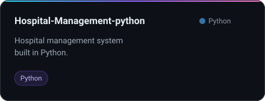

 

  

<h2 align="center">About Me</h2>

- 🎓 B.Sc. in Computer Science & Engineering at **Rajshahi University of Engineering & Technology (RUET)**, Bangladesh
- 💻 Full-stack web developer: React front ends with MongoDB / Mongoose back ends
- ⚙️ Also work with C++, Python and Assembly for systems-level and problem-solving work
- 🗄️ Relevant coursework: Database Systems, Computer Architecture, Theory of Computation, Embedded Systems
- 🔭 Currently building **CivicNest**, a full-stack web application
- 💼 Open to internships and junior developer opportunities

<!-- GIF SLOT (optional): save your GIF as coding.gif, then delete the GIF START line and the GIF END line below so it shows. -->
<!-- GIF START

  

GIF END -->

<h2 align="center">Skills</h2>

  

<h2 align="center">Featured Projects</h2>

  
  
  
  
  
  

<h2 align="center">Let's Connect</h2>

<!-- LinkedIn and Portfolio (add when ready): replace the YOUR-... parts, then delete the LINKS START line and the LINKS END line below so they show. -->
<!-- LINKS START

LINKS END -->

