## Hᴇʏ, ɪ'ᴍ Shoumik

*Full-stack developer in the making · CSE @ RUET*

I build web apps end to end: React and Next.js on the front, Node.js with MongoDB or PostgreSQL behind it. I also like knowing what happens underneath, which is why C++, Python and Assembly are part of the mix.

- 🎓 Studying Computer Science & Engineering at **RUET**, Rajshahi
- 🛠️ Building **GitPrism** with Next.js and PostgreSQL, and learning backend as I go
- 🚀 Shipped **CivicNest**, **hero.io** and **ToyTopia** this year
- 💼 **Open to internships**: the quickest way to reach me is [email](mailto:orghodutta@gmail.com)

 

---

<h2 align="center">Tᴇᴄʜ sᴛᴀᴄᴋ</h2>

  

  

---

<h2 align="center">Pʀᴏᴊᴇᴄᴛs</h2>

<table width="100%">
  <tr>
    <td width="50%" valign="top">
      <b>GitPrism</b> &nbsp;<code>in progress</code> 
      What I'm building right now. 
      <code>Next.js</code> <code>PostgreSQL</code>
    </td>
    <td width="50%" valign="top">
      <b><a href="https://github.com/argh-finds404/CivicNest-Client">CivicNest</a></b> 
      A full-stack civic platform. <a href="https://github.com/argh-finds404/CivicNest-Client">Client</a> · <a href="https://github.com/argh-finds404/CivicNest-Server">Server</a> 
      <code>React</code> <code>Node.js</code> <code>MongoDB</code> <code>Mongoose</code>
    </td>
  </tr>
  <tr>
    <td width="50%" valign="top">
      <b><a href="https://github.com/argh-finds404/hero.io-app-store">hero.io</a></b> 
      An app store with a frosted-glass look and a live analytics dashboard. 
      <code>React 19</code> <code>Router 7</code> <code>Tailwind 4</code> <code>Recharts</code>
    </td>
    <td width="50%" valign="top">
      <b><a href="https://github.com/argh-finds404/ToyTopia-toy-store">ToyTopia</a></b> 
      A toy store that plays more like a game than a shop. 
      <code>React</code> <code>Tailwind</code> <code>Framer Motion</code> <code>Firebase</code>
    </td>
  </tr>
  <tr>
    <td width="50%" valign="top">
      <b><a href="https://github.com/argh-finds404/Joruri-seba-emergency-hotline">Joruri Seba</a></b> 
      Bangladesh's emergency helplines in one place, with call history. 
      <code>HTML</code> <code>Tailwind</code> <code>DaisyUI</code> <code>JavaScript</code>
    </td>
    <td width="50%" valign="top">
      <b><a href="https://github.com/argh-finds404/Hospital-Management-python">Hospital Management</a></b> 
      A hospital management system in Python. 
      <code>Python</code>
    </td>
  </tr>
</table>

---

<h2 align="center">Aᴄᴛɪᴠɪᴛʏ</h2>

<picture>
  <source media="(prefers-color-scheme: dark)" srcset="https://raw.githubusercontent.com/argh-finds404/argh-finds404/output/github-contribution-grid-snake-dark.svg" />
  <source media="(prefers-color-scheme: light)" srcset="https://raw.githubusercontent.com/argh-finds404/argh-finds404/output/github-contribution-grid-snake.svg" />
  
</picture>

---

<h2 align="center">Tʜᴏᴜɢʜᴛ ᴏғ ᴛʜᴇ ᴅᴀʏ</h2>

  
   
  A new quote every morning. Inspirational quotes provided by <a href="https://zenquotes.io/">ZenQuotes API</a>.

---

<h2 align="center">Cᴏɴɴᴇᴄᴛ ᴡɪᴛʜ ᴍᴇ</h2>

<!-- Add your links later: replace each "#" below with your profile URL. -->

  &nbsp;
  &nbsp;
  &nbsp;
  &nbsp;
  

Open to internships · <a href="mailto:orghodutta@gmail.com">orghodutta@gmail.com</a>

